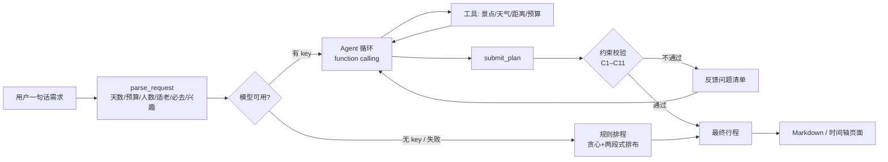

# 广州行程规划 Agent

一个真正会「自己查、自己排、自己检查」的行程规划 Agent：模型负责理解需求与排布，**代码负责把关**——预算、开放时间、闭馆日、通行时间、步行强度这些硬约束由校验器逐条判定，不通过就把问题清单打回给模型重排，最多 3 轮；模型不可用或排不出来时自动降级到规则排程，页面永远有结果。

在线演示：**https://trip-plan-agent.onrender.com**（免费实例冷启动约 30–60 秒）


## 它和普通「聊天式攻略生成」的区别

| | 常见做法 | 本项目 |
|---|---|---|
| 工具 | 无，全凭模型记忆 | 5 个真实工具：`search_poi` / `get_weather` / `distance_between` / `budget_calc` / `submit_plan` |
| 正确性 | 靠提示词「请注意」 | 11 条硬约束**用代码校验**，不过就打回重排（C1–C11） |
| 失败处理 | 一本正经胡说 | 校验失败→反馈问题清单→重排；模型挂了→规则版兜底 |
| 可重复 | 每次都不一样 | 规则版确定可复现，21 条 pytest 用例守着 |
| 公网成本 | 容易被刷爆 key | 每分钟 6 次 + 每日总量上限 + 300 字输入上限 |

## 架构



## 硬约束（`constraints.py`）

| 编号 | 约束 | 说明 |
|---|---|---|
| C1 | 天数 | 必须等于用户要求 |
| C2 | 日期连续 | 从出发日连续排 |
| C3 | 不重复 | 同一景点不能出现两次；id 必须来自工具返回 |
| C4 | 开放时间 | 景点时间必须落在营业区间内 |
| C5 | 闭馆日 | 周一闭馆的馆不能排周一 |
| C6 | 通行时间 | 相邻景点之间留够 `distance_between` 的分钟数 |
| C7 | 强度 | 单日 ≤10 小时、步行强度 ≤ 用户要求（必去景点豁免） |
| C8 | 预算 | 门票+餐饮+交通（全团合计）≤ 用户预算；"每人/人均" 会自动 ×人数换算成总预算 |
| C9 | 密度 | 单日 ≤4 个景点 |
| C10 | 必去 | 用户点名的景点必须安排 |
| C11 | 作息 | 只在 08:00–22:00 之间活动 |

软约束：S1 午餐 11:30–13:00 留空（不通过只提醒，不拦截）。

## 快速开始

```bash
conda create -n tripagent python=3.11 -y
conda activate tripagent
pip install -r requirements.txt

# 可选：配置模型（不配就走规则版，页面照样能用）
export TRIP_LLM_API_KEY=sk-xxx          # 阿里云百炼 / 任意 OpenAI 兼容网关
export TRIP_LLM_BASE_URL=https://dashscope.aliyuncs.com/compatible-mode/v1
export TRIP_LLM_MODEL=qwen-plus

python app.py                            # http://127.0.0.1:8000
python -m pytest tests -q                # 34 条用例（解析 + 排程 + 渲染）
```

## API

```
GET  /health                     -> {"ok": true, "llm": true|false}
POST /api/plan                   -> 同步规划（一次请求等到底，适合 curl / 脚本）
                                    {"text": "广州 2 天，两个人，预算 1600，带父母不想走太多路"}
POST /api/plan_async             -> 异步规划（页面用这个）：{"text": "..."} → {"task_id": "..."}
GET  /api/plan_task/{task_id}    -> 轮询：running 时返回 progress/stage，完成时返回完整结果
                                    返回 plan / validation / markdown / source(llm|rules(fallback)|llm-partial)
```

限流：每 IP 每分钟 `TRIP_RATE_PER_MIN`（默认 6）次、每天 `TRIP_DAILY_CAP`（默认 300）次，
单条需求 ≤300 字；异步任务结果保留 15 分钟。

## 目录

```
trip_agent/
├── app.py               # FastAPI 入口 + 限流 + 静态页
├── planner.py           # 需求解析 / Agent 循环 / 规则兜底
├── constraints.py       # 11 条硬约束校验 + 反馈生成
├── tools.py             # 5 个工具（景点库/天气/距离/预算/Markdown 导出）
├── data/pois_gz.json    # 110 个广州景点，覆盖 11 个行政区（教学用近似数据）
├── static/index.html    # 单页时间轴界面（无前端构建）
├── render.yaml          # Render 一键部署（Blueprint）
└── tests/test_cases.py  # 34 条用例
```

## 已知边界

- 景点数据是教学用近似值（坐标/票价/开放时间以官方为准），只覆盖广州；
- 规则版是「能跑通」的下限，模型版排得更自然；两者输出同一结构，走同一套校验；
- 公网演示是单实例、内存态限流，重启即清零（够演示，不追求生产级）。
